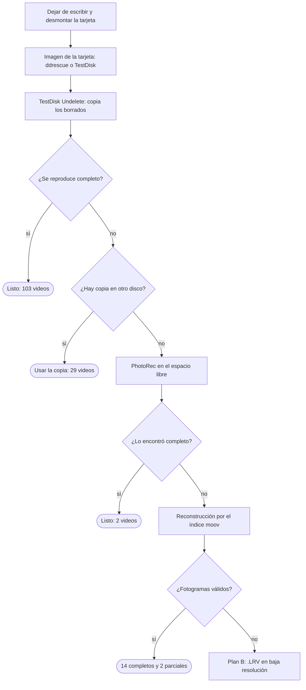

# Recuperar videos borrados de una tarjeta SD de GoPro

[English](README.md) · [Português](README.pt-BR.md) · **Español**

De 155 videos borrados de una tarjeta de GoPro, 148 volvieron completos en Full HD y 2 volvieron a medias, solo con herramientas gratuitas. Esta guía explica el paso a paso en Linux, macOS y Windows, y los scripts de [`scripts/`](scripts/) reconstruyen los videos que ninguna herramienta lista pudo recuperar.

> **Probado en:** Linux (Arch). Los comandos de macOS y Windows siguen la documentación de cada herramienta, pero no se ejecutaron en esos sistemas. Los scripts están hechos para **FAT32 + GoPro** (`GH*.MP4`); otras cámaras o sistemas de archivos requieren ajustes.

## Contenido

- [Qué pasó](#qué-pasó)
- [Regla de oro: dejar de escribir en la tarjeta](#regla-de-oro-dejar-de-escribir-en-la-tarjeta)
- [Visión general](#visión-general)
- [Herramientas](#herramientas)
- [Paso 1: identificar la tarjeta](#paso-1-identificar-la-tarjeta)
- [Paso 2: crear la imagen de la tarjeta](#paso-2-crear-la-imagen-de-la-tarjeta)
- [Paso 3: TestDisk Undelete](#paso-3-testdisk-undelete)
- [Paso 4: comprobar los videos y eliminar duplicados](#paso-4-comprobar-los-videos-y-eliminar-duplicados)
- [Paso 5: PhotoRec en el espacio libre](#paso-5-photorec-en-el-espacio-libre)
- [Paso 6 (avanzado): reconstruir videos fragmentados](#paso-6-avanzado-reconstruir-videos-fragmentados)
- [Plan B: los archivos LRV y el reescalado](#plan-b-los-archivos-lrv-y-el-reescalado)
- [Resultado de este caso](#resultado-de-este-caso)
- [Trampas](#trampas)

## Qué pasó

Los videos desaparecieron en tres pasos en la computadora, pero seguían físicamente en la tarjeta: una microSD de 32 GB en FAT32, de una GoPro, con 153 videos grabados en dos días.

| Cuándo | Qué se hizo | Efecto en la tarjeta |
| --- | --- | --- |
| 07:48 | Los `.MP4` se movieron de la tarjeta a una carpeta en otro disco | Mover a otro disco = copiar y borrar de la tarjeta |
| 07:59 | Parte de los videos se borró de esa carpeta | Fueron a la papelera de ese disco |
| 08:18 | Se vació la papelera | De 153, solo quedaban 51 en el otro disco |

Borrar un archivo en FAT32 no elimina los datos. El sistema solo marca la entrada del directorio como borrada y libera sus bloques (clústeres) en la tabla FAT. El contenido sigue ahí hasta que algo nuevo se escribe encima.

Tres cosas ayudaron:

- La tarjeta no recibió ninguna escritura después de mover los videos, y 27 de sus 30 GB estaban libres.
- Junto con cada video, la GoPro graba un `.LRV` (copia en 768×432) y un `.THM` (miniatura). Esos archivos no se borraron y sirvieron de red de seguridad y de referencia.
- Los 51 videos que quedaron en el otro disco estaban íntegros y cubrieron parte de los que salieron dañados de la tarjeta.

## Regla de oro: dejar de escribir en la tarjeta

Cada escritura nueva en la tarjeta puede destruir para siempre un archivo borrado, así que el primer paso es dejar de usarla.

- No grabes con la cámara ni copies archivos a la tarjeta.
- No la formatees y no aceptes "reparar" ni "examinar y corregir".
- No guardes los archivos recuperados en la propia tarjeta.
- Desmonta la tarjeta lo antes posible. Mientras está montada, el sistema puede escribir miniaturas, índices o una papelera en ella.

| Sistema | Cómo desmontar sin escribir |
| --- | --- |
| Linux (cualquier distro) | `udisksctl unmount -b /dev/sdX1` (o `sudo umount /dev/sdX1`) |
| macOS | `diskutil unmountDisk /dev/diskN` |
| Windows | Expulsar en el Explorador, o dejar el disco en solo lectura: `diskpart` → `list disk` → `select disk N` → `attributes disk set readonly` |

En Windows, la tarjeta conectada suele recibir una carpeta `System Volume Information`, y el sistema puede ofrecer "examinar y corregir". Recházalo. El modo de solo lectura de `diskpart` evita las dos cosas.

## Visión general

La recuperación es una serie de intentos, del más simple al más laborioso. Cada video que vuelve completo sale de la cola, y solo los que fallaron pasan a la etapa siguiente. Las cifras son de este caso (155 videos).



## Herramientas

Todo aquí es gratuito y de código abierto. TestDisk y PhotoRec vienen en el mismo paquete.

| Herramienta | Para qué | ¿Obligatoria? |
| --- | --- | --- |
| [TestDisk / PhotoRec](https://www.cgsecurity.org/wiki/TestDisk) | Recuperar borrados con su nombre (TestDisk) y por firma de archivo (PhotoRec) | Sí |
| [GNU ddrescue](https://www.gnu.org/software/ddrescue/) | Crear la imagen de la tarjeta, tolerando sectores dañados | Recomendada (en Windows, usa TestDisk) |
| [FFmpeg](https://ffmpeg.org/) (`ffmpeg` y `ffprobe`) | Comprobar que el video se reproduce, recortar y reescalar | Sí, para comprobar |
| [Python 3](https://www.python.org/) | Ejecutar los scripts del Paso 6 | Solo en el Paso 6 |
| [untrunc](https://github.com/anthwlock/untrunc) | Reconstruir el índice de un MP4 truncado | Opcional (no resolvió este caso) |

### Instalación

| Sistema | Comando |
| --- | --- |
| Ubuntu / Debian / Mint | `sudo apt install testdisk gddrescue ffmpeg python3` |
| Fedora | `sudo dnf install testdisk ddrescue ffmpeg-free python3` |
| Arch / Manjaro | `sudo pacman -S testdisk ddrescue ffmpeg python` |
| openSUSE | `sudo zypper install testdisk ddrescue ffmpeg python3` |
| macOS ([Homebrew](https://brew.sh/)) | `brew install testdisk ddrescue ffmpeg python` |
| Windows | TestDisk: descarga el `.zip` para Windows del [sitio oficial](https://www.cgsecurity.org/wiki/TestDisk_Download) y descomprímelo. FFmpeg y Python: `winget install Gyan.FFmpeg` y `winget install Python.Python.3.12` |

Los nombres de los paquetes cambian entre versiones de las distros. Si alguno no existe, búscalo con `apt search`, `dnf search`, `pacman -Ss` o `zypper search`. En Fedora y openSUSE, el FFmpeg completo viene de repositorios adicionales (RPM Fusion y Packman), pero la versión básica basta para comprobar videos.

`untrunc` tiene paquete en Arch, en el AUR (`yay -S untrunc-git`). Si tu distro no lo tiene, compílalo desde el [código fuente](https://github.com/anthwlock/untrunc).

## Paso 1: identificar la tarjeta

Antes de cualquier comando que lea el disco, confirma el nombre del dispositivo por su tamaño. Equivocarse de disco aquí significa leer, o peor, escribir en el disco equivocado.

| Sistema | Comando | Cómo aparece la tarjeta |
| --- | --- | --- |
| Linux | `lsblk -o NAME,SIZE,FSTYPE,LABEL,MOUNTPOINT` | `/dev/sdX` (lector USB) o `/dev/mmcblk0` (lector integrado) |
| macOS | `diskutil list` | `/dev/diskN` (external, physical) |
| Windows | Administración de discos (`diskmgmt.msc`) o, en PowerShell, `Get-Disk` | Disco N, extraíble |

En este caso, `lsblk` mostró:

```
sdc          29.7G
└─sdc1       29.7G vfat   /run/media/usuario/FA9E-2B30
```

29,7 GB es el tamaño real de una tarjeta vendida como de 32 GB, y `vfat` es FAT32. El disco completo es `sdc` y la partición es `sdc1`. La imagen del Paso 2 debe ser del disco completo.

Si la tarjeta no aparece en ningún lector, la falla es física y ningún programa la resuelve. En ese caso hace falta un laboratorio de recuperación.

## Paso 2: crear la imagen de la tarjeta

La imagen es una copia bit a bit de la tarjeta completa, incluido el espacio libre donde están los borrados. Todo el trabajo restante se hace sobre ella, y la tarjeta queda guardada intacta.

Así se protege una tarjeta que esté fallando, se puede repetir cualquier intento sin riesgo y la tarjeta se lee una sola vez. Necesitas espacio libre mayor que la tarjeta (32 GB para una tarjeta de 32 GB), **fuera de la tarjeta**.

### Linux y macOS: ddrescue

```bash
# Linux (cambia sdc por tu disco: el disco completo, sin número)
sudo ddrescue -d -r3 /dev/sdc ~/sdcard.img ~/sdcard.map

# macOS (cambia 4 por el número de diskutil; rdisk es más rápido que disk)
diskutil unmountDisk /dev/disk4
sudo ddrescue -r3 /dev/rdisk4 ~/sdcard.img ~/sdcard.map
```

- `-d` lee directamente del dispositivo, sin caché (solo en Linux).
- `-r3` reintenta hasta 3 veces los sectores que den error.
- El archivo `.map` registra el progreso. Si la copia se interrumpe, ejecuta el mismo comando y continúa donde quedó.

Al final, revisa el `.map`: el estado `+` en todo el rango significa que se leyeron todos los sectores. En este caso se leyeron 31,9 GB sin ningún error.

### Windows: TestDisk (Image Creation)

El propio TestDisk crea la imagen, y el archivo sirve para los pasos siguientes.

1. Ejecuta `testdisk_win.exe` como administrador.
2. `Create` (sin registro) y elige la tarjeta por su tamaño.
3. Tipo de tabla: `Intel`.
4. `Advanced`, selecciona la partición FAT32 y elige `Image Creation`.
5. Elige una carpeta de destino en otro disco. TestDisk graba un archivo `image.dd`.

Con `Image Creation` la imagen es solo de la partición, no del disco completo. Para este tipo de recuperación es suficiente, y los scripts del Paso 6 aceptan los dos tipos de imagen.

## Paso 3: TestDisk Undelete

TestDisk lee las entradas borradas del directorio y devuelve los archivos con su nombre original. En este caso fue la etapa que más recuperó: 103 videos completos de una vez.

Crea primero la carpeta de destino y abre TestDisk sobre la imagen:

```bash
mkdir ~/recuperado
testdisk ~/sdcard.img        # Linux y macOS
```

En Windows, ejecuta `testdisk_win.exe` y elige `image.dd`, o ejecuta `testdisk_win.exe image.dd` en la terminal.

| Pantalla | Qué hacer | Nota |
| --- | --- | --- |
| Selección del disco | Selecciona la imagen y `Proceed` | `(RO)` significa solo lectura. Es lo esperado |
| "Write access for this media is not available" | `Continue` | Solo avisa que la imagen no se modificará, y eso es bueno |
| Tipo de tabla | `Intel` (sugerido) | Las tarjetas SD usan tabla MBR |
| Menú principal | `Advanced` | |
| Lista de particiones | Selecciona la FAT32 y avanza con la **flecha derecha** hasta `Undelete` | La primera opción es `Boot`: no entres ahí |
| Raíz de la tarjeta | Flecha derecha en `DCIM` y luego en `100GOPRO` | Las horas aparecen en UTC |
| Lista de archivos | Los borrados aparecen **en rojo**, con `_` en lugar de la primera letra (`_H012073.MP4`) | Los blancos todavía existen |
| Selección | `a` marca todos; `:` marca solo el archivo actual | `a` marca **todo**, incluso lo que no se borró |
| Copia | `C` (mayúscula), elige la carpeta de destino y `C` otra vez | Al final: `Copy done! N ok, M failed` |

### Trampas de esta etapa

- **La pantalla `Boot`.** Muestra `Boot sector OK` y el aviso *First sectors … are not identical*, que es común e inofensivo. **Nunca** uses `Org. BS`, `Backup BS` ni `Rebuild BS` solo para recuperar archivos: reescriben el sector de arranque. Sal con `Quit`.
- **Más archivos de lo esperado.** Aquí salieron 621 archivos para 153 videos, por dos motivos. `a` copió también los `.LRV`, `.THM` y `.JPG` que todavía existían. Y una carpeta que también se había creado y borrado en la tarjeta guardaba una segunda entrada borrada para los mismos videos. El Paso 4 lo limpia.
- **Un archivo copiado no es un archivo bueno.** TestDisk lee desde el primer bloque del archivo y sigue en secuencia. Si el video se grabó disperso por la tarjeta, la copia sale con el tamaño correcto y el contenido equivocado. No hay ningún aviso: solo se sabe comprobando, en el Paso 4.

## Paso 4: comprobar los videos y eliminar duplicados

Un video solo cuenta como recuperado si se abre y se decodifica de principio a fin. De los 155 MP4 que copió TestDisk aquí, 103 pasaron y 52 salieron dañados, con el mensaje `moov atom not found`.

### 1. Comprobar cada video

La prueba rápida lee la duración del índice y decodifica los últimos 2 segundos. La prueba completa decodifica todo el video y es más lenta.

```bash
# Linux y macOS
cd ~/recuperado/DCIM/100GOPRO
for f in _H*.MP4; do
  d=$(ffprobe -v error -show_entries format=duration -of csv=p=0 "$f")
  e=$(ffmpeg -v error -sseof -2 -i "$f" -f null - 2>&1 | head -1)
  echo "$f | duración=${d:-ERROR} | ${e:-ok}"
done

# prueba completa de un archivo (ninguna línea = ningún error)
ffmpeg -v error -i GH012107.MP4 -f null -
```

```powershell
# Windows (PowerShell)
cd $HOME\recuperado\DCIM\100GOPRO
Get-ChildItem _H*.MP4 | ForEach-Object {
  $d = ffprobe -v error -show_entries format=duration -of csv=p=0 $_.Name
  "$($_.Name) | duración=$d"
}
```

Compara la duración con la del `.LRV` del mismo número (`GL012107.LRV` es el par de `GH012107.MP4`). Si coinciden y la prueba no muestra errores, el video está bien.

### 2. Eliminar duplicados con seguridad

Borra un archivo solo después de confirmar, byte a byte, que es idéntico a otro que se queda.

```bash
# Linux y macOS: borra la segunda copia solo si es idéntica
for f in segunda_carpeta/*.MP4; do cmp -s "$f" "${f#segunda_carpeta/}" && rm "$f"; done
```

```powershell
# Windows: compara por hash
Get-ChildItem segunda_carpeta\*.MP4 | ForEach-Object {
  if ((Get-FileHash $_.FullName).Hash -eq (Get-FileHash $_.Name).Hash) { Remove-Item $_.FullName }
}
```

### 3. Organizar

- Mueve los que pasaron a una carpeta `videos` y los que fallaron a `danados`.
- Renombra `_H0…` a `GH0…`. En bash: `for f in _H*.MP4; do mv "$f" "G${f#_}"; done`. En PowerShell: `Get-ChildItem _H*.MP4 | Rename-Item -NewName { 'G' + $_.Name.Substring(1) }`.
- Busca copias buenas en otros discos antes de insistir con los dañados. Aquí, 29 de los 52 dañados estaban íntegros en el otro disco, y bastó compararlos por nombre y tamaño exacto en bytes.

## Paso 5: PhotoRec en el espacio libre

PhotoRec ignora el sistema de archivos y busca firmas de archivo en el espacio libre, como la cabecera de un MP4. Aquí encontró 132 videos, pero casi todos ya los había salvado TestDisk: solo 2 eran nuevos.

Los archivos vuelven con nombres genéricos (`f3358528.mp4`). Para saber cuál es cuál, compara la fecha de grabación interna (`creation_time`) y la duración con las del `.LRV`.

### Modo interactivo (cualquier sistema)

```bash
photorec ~/sdcard.img            # Linux y macOS
photorec_win.exe image.dd        # Windows (o qphotorec_win.exe, con ventana)
```

1. Selecciona la imagen y la partición FAT32.
2. En `File Opt`, pulsa `s` para desmarcar todo y marca solo `mov`. Es el tipo con el que PhotoRec detecta MP4.
3. `Search`, luego `Other` (tipo de sistema de archivos para FAT/NTFS) y luego `Free` (solo el espacio libre).
4. Elige una carpeta de destino fuera de la tarjeta y confirma con `C`.

### Modo automático (Linux y macOS)

```bash
photorec /log /d ~/recuperado/photorec/r /cmd ~/sdcard.img \
  1,fileopt,everything,disable,mov,enable,freespace,search
```

### Identificar los recuperados

```bash
ffprobe -v error -show_entries format=duration:format_tags=creation_time \
  -of csv=p=0 archivo.mp4
```

Un archivo de PhotoRec pertenece a un video cuando su `creation_time` y su duración coinciden con las del `.LRV` de ese video.

## Paso 6 (avanzado): reconstruir videos fragmentados

Los videos que ninguna herramienta lista salvó se reconstruyeron con un script, bloque a bloque, usando el índice del propio video como guía. Así volvieron 14 videos completos y 2 parciales, de 17 intentos.

### Por qué TestDisk y PhotoRec fallaron con ellos

La GoPro graba el MP4 y el `.LRV` **al mismo tiempo**, y por eso los dos quedan intercalados en la tarjeta. En esta tarjeta el patrón fue de 160 bloques de 32 KB de MP4 (5 MB), seguidos de 16 bloques de LRV (512 KB), una y otra vez:

```
tarjeta: [MP4 5 MB][LRV 512 KB][MP4 5 MB][LRV 512 KB][MP4 5 MB] ...
```

Además, el comienzo del video a veces está en otra región de la tarjeta. Al borrar el archivo desaparece la tabla que indicaba el orden de esos pedazos. TestDisk y PhotoRec leen en secuencia, y por eso pegan pedazos del LRV y de otros videos dentro del MP4.

`untrunc` tampoco lo resolvió. Reconstruye el índice de un MP4 cortado, pero aquí el índice estaba íntegro; lo que estaba desordenado eran los datos.

### Cómo funciona la reconstrucción

Al final de cada MP4 de GoPro está el `moov`, el índice que da la posición y el tamaño exactos de cada fotograma de video. Sobrevive en la tarjeta y funciona como un mapa.

1. **Encontrar los índices sueltos.** [`scan_moov.py`](scripts/scan_moov.py) recorre la imagen buscando todos los `moov`. Aquí encontró 308: uno por MP4 y uno por LRV.
2. **Saber de qué video es cada índice.** La fecha de grabación y la duración del `moov` son iguales a las del `.LRV` del mismo video. Eso identificó 19 de los 21 que faltaban.
3. **Encontrar el comienzo.** El primer bloque de la copia de TestDisk era correcto. [`rebuild_mp4.py`](scripts/rebuild_mp4.py) busca ese bloque en la imagen y empieza desde ahí.
4. **Avanzar bloque a bloque, comprobando cada fotograma.** Un fotograma H.264 es una secuencia de pedazos cuyos tamaños deben sumar exactamente el tamaño que indica el índice. Si suman, los bloques son correctos. Si no, el script busca en la imagen el bloque donde el fotograma cierra y sigue desde ahí.
5. **Hacer lo mismo de atrás hacia adelante**, desde el final del `moov`, y unir las dos mitades. Si queda un hueco en el medio, se limita a ese tramo.
6. **Comprobar el resultado** con `ffmpeg -v error -i video.MP4 -f null -` y mirando algunos fotogramas.

### Cómo usar los scripts

Necesitan Python 3 (solo la biblioteca estándar) y `ffprobe` en el PATH. Ninguno escribe en la imagen.

```bash
# 1. lista todos los índices de la imagen: posición, tamaño, fecha (UTC), duración
python3 scripts/scan_moov.py sdcard.img > moovs.txt

# 2. fecha y duración del .LRV del video que falta
ffprobe -v error -show_entries format=duration:format_tags=creation_time \
  -of csv=p=0 GL012107.LRV

# 3. en moovs.txt, busca las líneas con la misma fecha y duración
#    (normalmente dos: una del MP4 y otra del LRV)

# 4. reconstruye con cada una; la del LRV se rechaza ("does not line up")
python3 scripts/rebuild_mp4.py sdcard.img <posición> <tamaño> danados/GH012107.MP4 reconstruidos/GH012107.MP4

# 5. comprueba
ffmpeg -v error -i reconstruidos/GH012107.MP4 -f null -
```

El 4.º argumento es la copia dañada que generó TestDisk: el script usa su primer bloque como punto de partida. En Windows, usa `py` en lugar de `python3`. Los scripts aceptan tanto la imagen del disco completo (`sdcard.img`) como la de la partición que genera TestDisk (`image.dd`).

Si el video sale parcial, guarda solo el tramo bueno, sin recodificar, usando el número de fotogramas que mostró la pasada hacia adelante: `ffmpeg -i GH012161.MP4 -t 12.7 -map 0:v -map 0:a -c copy GH012161_parcial.MP4` (782 fotogramas ÷ 59,94 fps ≈ 13 s).

### Prueba

[`tests/run_test.sh`](tests/run_test.sh) crea dos imágenes FAT32 sintéticas (solo la partición y el disco completo con MBR), dispersa dentro de ellas un video real de GoPro como lo hace la cámara y comprueba que el archivo reconstruido sea idéntico byte a byte al original. Necesita Linux con `mkfs.fat` y `sfdisk`.

```bash
tests/run_test.sh ruta/al/GH0xxxxx.MP4
```

### Lo que aprendimos

- **No confíes en la tabla FAT para estos videos.** Algunos bloques de un video figuraban como pertenecientes al `.LRV` de otro video. El script solo funciona porque se guía por la comprobación de los fotogramas, no por "bloque libre u ocupado".
- **La entrada del directorio puede mentir sobre el tamaño.** Un video figuraba con 107 MB, pero su propia cabecera (`ftyp` + `free` + `mdat` + `moov`) decía 181 MB. El tamaño correcto es el de la cabecera.
- **Busca primero cerca.** La primera versión, que recorría toda la imagen en cada salto, tardó 43 minutos en un video. Buscando antes en los 20 000 bloques siguientes, 11 videos tardaron 13 minutos.

## Plan B: los archivos LRV y el reescalado

El `.LRV` no recupera el video original, pero garantiza que ninguna escena se pierda del todo. Aquí, cada video que no volvió completo todavía tenía su `.LRV`, salvo dos cuyo `.LRV` también estaba dañado.

- **Qué es:** una segunda grabación de la misma escena, hecha por la GoPro al mismo tiempo, en 768×432 a 60 fps y unos 4 Mbps. Es un MP4 normal con otra extensión, y se abre en VLC o mpv.
- **Qué no es:** un pedazo del MP4. El detalle que solo existía en el original no está en el `.LRV`, y ningún programa puede sacarlo de ahí.
- **Guarda los `.LRV` antes que nada.** Siguen en la tarjeta y son la red de seguridad. Copia la carpeta `DCIM` completa a la computadora al principio.

### Reescalado simple (FFmpeg, cualquier sistema)

Deja el video en 1080p, más suave y sin bloques de píxeles, pero sin detalle nuevo. Sirve para editar junto con videos Full HD.

```bash
ffmpeg -i GL012133.LRV -vf "scale=1920:1080:flags=lanczos,unsharp=5:5:0.6" \
  -c:v libx264 -crf 18 -preset fast -c:a copy GH012133_1080p.mp4
```

En PowerShell, el mismo comando funciona cambiando la `\` del final de la línea por un acento grave (`` ` ``), o escribiéndolo todo en una línea. En la prueba, `-preset slow` tardó 1 min 50 s en 26 s de video; `-preset fast` tarda más o menos la mitad.

### Reescalado con IA

Herramientas como Real-ESRGAN (mediante [Video2X](https://github.com/k4yt3x/video2x), gratuito) o Topaz Video AI (de pago) hacen la imagen más nítida, pero **inventan** detalle plausible. Es una aproximación, no el original. En una GPU integrada es muy lento (según la estimación de este caso, cerca de 1 hora para un clip de 2 minutos a 60 fps), así que solo vale la pena para los clips más importantes.

## Resultado de este caso

148 de los 155 videos volvieron completos, en 1920×1080 y con audio. Cuatro tienen 1 fotograma dañado, lo que significa como mucho un fallo de menos de 1 segundo en la imagen.

| Etapa | Videos salvados | Tiempo aproximado |
| --- | --- | --- |
| TestDisk Undelete | 103 | minutos |
| Copia que quedó en el otro disco | 29 | segundos |
| PhotoRec en el espacio libre | 2 | unos 30 min |
| Reconstrucción por el índice | 14 completos + 2 parciales | 43 min (1.er video) + unos 30 min (los otros 16) |
| **Total** | **148 completos + 2 parciales** | |

Los 7 que no volvieron completos:

| Video | Duración | Estado | Qué queda |
| --- | --- | --- | --- |
| `GH012236` | 32 s | Parcial: 19 s buenos | El tramo + el `.LRV` completo |
| `GH012161` | 48 s | Parcial: 13 s buenos | El tramo + el `.LRV` completo |
| `GH012133` | 6 s | Perdido: solo 0,15 s buenos | El `.LRV` completo |
| `GH012077`, `GH012078` | 1 s cada uno | Descartados (grabación accidental) | `.LRV` |
| `GH012227`, `GH012228` | ? | Sin índice en la tarjeta, no se intentó | Solo la miniatura |

## Trampas

Ninguno de estos errores costó datos, pero cada uno costó tiempo.

| Qué pasó | Por qué | Cómo evitarlo |
| --- | --- | --- |
| Entrar en la pantalla `Boot` de TestDisk en vez de `Undelete` | Las opciones están una al lado de la otra | Avanza con la flecha derecha hasta `Undelete`. En la pantalla `Boot`, solo `Quit` |
| 621 archivos copiados para 153 videos | `a` marca todo, y había dos entradas borradas por video | Comprobar y eliminar duplicados en el Paso 4 |
| Video copiado con el tamaño correcto que no se reproduce | Video grabado disperso; TestDisk lee en secuencia | Comprobar siempre con `ffmpeg` antes de borrar nada |
| `Client.Timeout exceeded` al instalar desde el AUR | El AUR estaba inestable | Clonar el espejo de GitHub: `git clone --branch untrunc-git --single-branch https://github.com/archlinux/aur.git` y luego `makepkg -si` |
| `command not found: cp` en medio de un script | En zsh, `path` está ligada a `PATH`; usar `path` como nombre de variable borró el `PATH` | Nunca uses `path` como nombre de variable en zsh |
| `untrunc` se detuvo en el 6 % de la imagen | Un tramo de datos inválidos rompió el recorrido | Recorrer con un script propio (`scan_moov.py`) |
| La reconstrucción se detenía por "alineación" | La entrada del directorio tenía el tamaño equivocado | Tomar el tamaño de la cabecera del MP4 |

Cuidados que valieron la pena:

- Trabajar siempre sobre la imagen, con la tarjeta guardada.
- Guardar todo en un disco con espacio de sobra.
- Borrar solo lo que se confirmó byte a byte como duplicado.
- Formatear la tarjeta solo después de comprobar los videos en su destino final.

## Licencia

[MIT](LICENSE)
