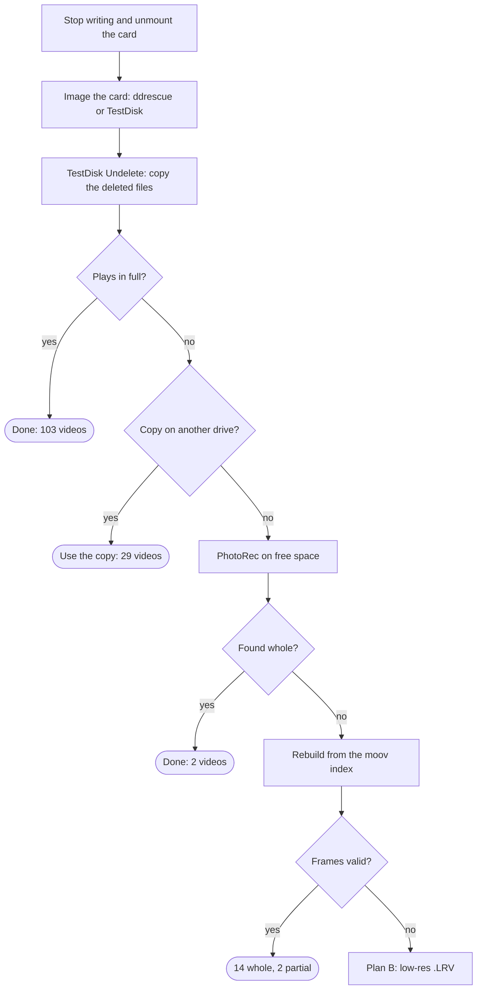

# Recovering deleted videos from a GoPro SD card

**English** · [Português](README.pt-BR.md) · [Español](README.es.md)

Of 155 deleted videos on a GoPro card, 148 came back whole in Full HD and 2 came back in part, using only free tools. This guide walks through the steps on Linux, macOS and Windows, and the scripts in [`scripts/`](scripts/) rebuild the videos no ready-made tool could.

> **Tested on:** Linux (Arch). The macOS and Windows commands follow each tool's documentation but were not run on those systems. The scripts were made for **FAT32 + GoPro** (`GH*.MP4`); other cameras or file systems need changes.

## Contents

- [What happened](#what-happened)
- [Golden rule: stop writing to the card](#golden-rule-stop-writing-to-the-card)
- [Overview](#overview)
- [Tools](#tools)
- [Step 1: identify the card](#step-1-identify-the-card)
- [Step 2: image the card](#step-2-image-the-card)
- [Step 3: TestDisk Undelete](#step-3-testdisk-undelete)
- [Step 4: check the videos and remove duplicates](#step-4-check-the-videos-and-remove-duplicates)
- [Step 5: PhotoRec on free space](#step-5-photorec-on-free-space)
- [Step 6 (advanced): rebuild fragmented videos](#step-6-advanced-rebuild-fragmented-videos)
- [Plan B: the LRV files and upscaling](#plan-b-the-lrv-files-and-upscaling)
- [Results of this case](#results-of-this-case)
- [Pitfalls](#pitfalls)

## What happened

The videos disappeared in three steps on the computer, but were still physically on the card: a 32 GB FAT32 microSD from a GoPro, with 153 videos recorded over two days.

| When | What was done | Effect on the card |
| --- | --- | --- |
| 07:48 | The `.MP4` files were moved from the card to a folder on another drive | Moving to another drive = copy, then delete from the card |
| 07:59 | Some videos were deleted from that folder | They went to that drive's trash |
| 08:18 | The trash was emptied | Of 153 videos, only 51 were left on the other drive |

Deleting a file on FAT32 does not wipe the data. The system only marks the directory entry as deleted and frees its blocks (clusters) in the FAT. The content stays there until something new is written over it.

Three things helped:

- Nothing was written to the card after the videos were moved, and 27 of its 30 GB were free.
- Next to every video, the GoPro records an `.LRV` (a 768×432 copy) and a `.THM` (thumbnail). Those were not deleted and served as a safety net and a reference.
- The 51 videos left on the other drive were intact and covered some of the ones that came back corrupted from the card.

## Golden rule: stop writing to the card

Any new write to the card can destroy a deleted file for good, so the first step is to stop using it.

- Do not record with the camera or copy files to the card.
- Do not format it and do not accept "repair" or "scan and fix".
- Never save recovered files to the card itself.
- Unmount the card as soon as you can. While mounted, the system may write thumbnails, indexes or a trash folder to it.

| System | How to unmount without writing |
| --- | --- |
| Linux (any distro) | `udisksctl unmount -b /dev/sdX1` (or `sudo umount /dev/sdX1`) |
| macOS | `diskutil unmountDisk /dev/diskN` |
| Windows | Eject in Explorer, or make the disk read-only: `diskpart` → `list disk` → `select disk N` → `attributes disk set readonly` |

On Windows, a connected card often gets a `System Volume Information` folder, and the system may offer to "scan and fix". Decline. The `diskpart` read-only mode prevents both.

## Overview

Recovery is a series of attempts, from the simplest to the hardest. Each video that comes back whole leaves the queue, and only the ones that failed move on to the next step. The numbers are from this case (155 videos).



## Tools

Everything here is free and open source. TestDisk and PhotoRec ship in the same package.

| Tool | What for | Required? |
| --- | --- | --- |
| [TestDisk / PhotoRec](https://www.cgsecurity.org/wiki/TestDisk) | Undelete with names (TestDisk) and by file signature (PhotoRec) | Yes |
| [GNU ddrescue](https://www.gnu.org/software/ddrescue/) | Image the card, tolerating bad sectors | Recommended (on Windows, use TestDisk) |
| [FFmpeg](https://ffmpeg.org/) (`ffmpeg` and `ffprobe`) | Check that a video plays, cut, upscale | Yes, for checking |
| [Python 3](https://www.python.org/) | Run the Step 6 scripts | Step 6 only |
| [untrunc](https://github.com/anthwlock/untrunc) | Rebuild the index of a truncated MP4 | Optional (did not solve this case) |

### Installing

| System | Command |
| --- | --- |
| Ubuntu / Debian / Mint | `sudo apt install testdisk gddrescue ffmpeg python3` |
| Fedora | `sudo dnf install testdisk ddrescue ffmpeg-free python3` |
| Arch / Manjaro | `sudo pacman -S testdisk ddrescue ffmpeg python` |
| openSUSE | `sudo zypper install testdisk ddrescue ffmpeg python3` |
| macOS ([Homebrew](https://brew.sh/)) | `brew install testdisk ddrescue ffmpeg python` |
| Windows | TestDisk: download the Windows `.zip` from the [official site](https://www.cgsecurity.org/wiki/TestDisk_Download) and extract it. FFmpeg and Python: `winget install Gyan.FFmpeg` and `winget install Python.Python.3.12` |

Package names change between distro releases. If one is missing, look it up with `apt search`, `dnf search`, `pacman -Ss` or `zypper search`. On Fedora and openSUSE the full FFmpeg comes from extra repositories (RPM Fusion, Packman), but the basic one is enough to check videos.

`untrunc` has an Arch package in the AUR (`yay -S untrunc-git`). If your distro has none, build it from [source](https://github.com/anthwlock/untrunc).

## Step 1: identify the card

Before any command that reads the disk, confirm the device name by its size. Picking the wrong disk here means reading, or worse, writing to the wrong one.

| System | Command | What the card looks like |
| --- | --- | --- |
| Linux | `lsblk -o NAME,SIZE,FSTYPE,LABEL,MOUNTPOINT` | `/dev/sdX` (USB reader) or `/dev/mmcblk0` (built-in reader) |
| macOS | `diskutil list` | `/dev/diskN` (external, physical) |
| Windows | Disk Management (`diskmgmt.msc`) or, in PowerShell, `Get-Disk` | Disk N, removable |

In this case `lsblk` showed:

```
sdc          29.7G
└─sdc1       29.7G vfat   /run/media/user/FA9E-2B30
```

29.7 GB is the real size of a card sold as 32 GB, and `vfat` is FAT32. The whole disk is `sdc` and the partition is `sdc1`. Image the whole disk in Step 2.

If the card does not show up in any reader, the fault is physical and no software will fix it. That calls for a data recovery lab.

## Step 2: image the card

An image is a bit-for-bit copy of the whole card, including the free space where the deleted files are. All the remaining work happens on it, and the card is put away untouched.

It protects a failing card, lets you repeat any attempt without risk, and means the card is read only once. You need free space larger than the card (32 GB for a 32 GB card), **not on the card**.

### Linux and macOS: ddrescue

```bash
# Linux (replace sdc with your disk: the whole disk, no number)
sudo ddrescue -d -r3 /dev/sdc ~/sdcard.img ~/sdcard.map

# macOS (replace 4 with the diskutil number; rdisk is faster than disk)
diskutil unmountDisk /dev/disk4
sudo ddrescue -r3 /dev/rdisk4 ~/sdcard.img ~/sdcard.map
```

- `-d` reads the device directly, without cache (Linux only).
- `-r3` retries sectors that fail, up to 3 times.
- The `.map` file records progress. If the copy stops, run the same command again and it resumes.

When it finishes, check the `.map`: a status of `+` for the whole range means every sector was read. In this case, 31.9 GB were read with no errors.

### Windows: TestDisk (Image Creation)

TestDisk can create the image itself, and the file works in the following steps.

1. Run `testdisk_win.exe` as administrator.
2. `Create` (no log) and pick the card by its size.
3. Partition table type: `Intel`.
4. `Advanced`, select the FAT32 partition and choose `Image Creation`.
5. Pick a destination folder on another drive. TestDisk writes an `image.dd` file.

`Image Creation` images the partition only, not the whole disk. That is enough for this kind of recovery, and the Step 6 scripts accept both kinds of image.

## Step 3: TestDisk Undelete

TestDisk reads the deleted directory entries and brings files back with their original names. In this case it was the step that recovered the most: 103 whole videos at once.

Create the destination folder first, then open TestDisk on the image:

```bash
mkdir ~/recovered
testdisk ~/sdcard.img        # Linux and macOS
```

On Windows, run `testdisk_win.exe` and choose `image.dd`, or run `testdisk_win.exe image.dd` in a terminal.

| Screen | What to do | Note |
| --- | --- | --- |
| Disk selection | Select the image, then `Proceed` | `(RO)` means read-only, as expected |
| "Write access for this media is not available" | `Continue` | It only warns that the image will not be changed, which is good |
| Partition table type | `Intel` (suggested) | SD cards use an MBR table |
| Main menu | `Advanced` | |
| Partition list | Select the FAT32 partition and press the **right arrow** until `Undelete` | The first option is `Boot`: do not go in there |
| Card root | Right arrow on `DCIM`, then on `100GOPRO` | Times are shown in UTC |
| File list | Deleted files show **in red**, with `_` instead of the first letter (`_H012073.MP4`) | White ones still exist |
| Selection | `a` selects all; `:` selects the current file | `a` selects **everything**, including files that were not deleted |
| Copy | `C` (capital), choose the destination folder, `C` again | At the end: `Copy done! N ok, M failed` |

### Pitfalls in this step

- **The `Boot` screen.** It shows `Boot sector OK` and the warning *First sectors … are not identical*, which is common and harmless. **Never** use `Org. BS`, `Backup BS` or `Rebuild BS` just to recover files: they rewrite the boot sector. Leave with `Quit`.
- **More files than expected.** Here, 621 files came out for 153 videos, for two reasons. `a` also copied the `.LRV`, `.THM` and `.JPG` files that still existed. And a folder that had also been created and deleted on the card held a second deleted entry for the same videos. Step 4 cleans this up.
- **A copied file is not a good file.** TestDisk reads from the file's first block onward, in sequence. If the video was recorded scattered across the card, the copy comes out with the right size and the wrong content. There is no warning: the only way to know is to check, in Step 4.

## Step 4: check the videos and remove duplicates

A video only counts as recovered if it opens and decodes from start to finish. Of the 155 MP4 files TestDisk copied here, 103 passed and 52 were corrupted, with `moov atom not found`.

### 1. Check each video

The quick test reads the duration from the index and decodes the last 2 seconds. The full test decodes the whole video and takes longer.

```bash
# Linux and macOS
cd ~/recovered/DCIM/100GOPRO
for f in _H*.MP4; do
  d=$(ffprobe -v error -show_entries format=duration -of csv=p=0 "$f")
  e=$(ffmpeg -v error -sseof -2 -i "$f" -f null - 2>&1 | head -1)
  echo "$f | duration=${d:-ERROR} | ${e:-ok}"
done

# full test of one file (no output = no errors)
ffmpeg -v error -i GH012107.MP4 -f null -
```

```powershell
# Windows (PowerShell)
cd $HOME\recovered\DCIM\100GOPRO
Get-ChildItem _H*.MP4 | ForEach-Object {
  $d = ffprobe -v error -show_entries format=duration -of csv=p=0 $_.Name
  "$($_.Name) | duration=$d"
}
```

Compare the duration with the `.LRV` of the same number (`GL012107.LRV` pairs with `GH012107.MP4`). If they match and the test shows no error, the video is good.

### 2. Remove duplicates safely

Only delete a file after confirming, byte for byte, that it is identical to one you keep.

```bash
# Linux and macOS: delete the second copy only if identical
for f in second_folder/*.MP4; do cmp -s "$f" "${f#second_folder/}" && rm "$f"; done
```

```powershell
# Windows: compare by hash
Get-ChildItem second_folder\*.MP4 | ForEach-Object {
  if ((Get-FileHash $_.FullName).Hash -eq (Get-FileHash $_.Name).Hash) { Remove-Item $_.FullName }
}
```

### 3. Organize

- Move the ones that passed to a `videos` folder and the ones that failed to `corrupted`.
- Rename `_H0…` to `GH0…`. In bash: `for f in _H*.MP4; do mv "$f" "G${f#_}"; done`. In PowerShell: `Get-ChildItem _H*.MP4 | Rename-Item -NewName { 'G' + $_.Name.Substring(1) }`.
- Look for good copies on other drives before working on the corrupted ones. Here, 29 of the 52 corrupted videos were intact on the other drive, found by name and exact size in bytes.

## Step 5: PhotoRec on free space

PhotoRec ignores the file system and looks for file signatures, such as an MP4 header, in free space. Here it found 132 videos, but almost all had already been saved by TestDisk: only 2 were new.

Files come back with generic names (`f3358528.mp4`). To tell which is which, compare the internal recording time (`creation_time`) and the duration with the `.LRV`.

### Interactive (any system)

```bash
photorec ~/sdcard.img            # Linux and macOS
photorec_win.exe image.dd        # Windows (or qphotorec_win.exe, with a window)
```

1. Select the image and the FAT32 partition.
2. In `File Opt`, press `s` to clear everything and tick only `mov`. That is the type under which PhotoRec detects MP4.
3. `Search`, then `Other` (file system type for FAT/NTFS), then `Free` (free space only).
4. Pick a destination folder off the card and confirm with `C`.

### Unattended (Linux and macOS)

```bash
photorec /log /d ~/recovered/photorec/r /cmd ~/sdcard.img \
  1,fileopt,everything,disable,mov,enable,freespace,search
```

### Identify what came back

```bash
ffprobe -v error -show_entries format=duration:format_tags=creation_time \
  -of csv=p=0 file.mp4
```

A PhotoRec file belongs to a video when its `creation_time` and duration match that video's `.LRV`.

## Step 6 (advanced): rebuild fragmented videos

The videos no ready-made tool saved were rebuilt by script, cluster by cluster, using the video's own index as a guide. That brought back 14 whole videos and 2 partial ones out of 17 attempts.

### Why TestDisk and PhotoRec failed on them

A GoPro writes the MP4 and the `.LRV` **at the same time**, so the two end up interleaved on the card. On this card the pattern was 160 clusters of 32 KB of MP4 (5 MB) followed by 16 clusters of LRV (512 KB), over and over:

```
card: [MP4 5 MB][LRV 512 KB][MP4 5 MB][LRV 512 KB][MP4 5 MB] ...
```

On top of that, the start of a video sometimes sits in another region of the card. Once the file is deleted, the table that said in which order these pieces go is gone. TestDisk and PhotoRec read in sequence, so they glue LRV pieces and pieces of other videos into the MP4.

`untrunc` did not help either. It rebuilds the index of a truncated MP4, but here the index was intact; what was out of order was the data.

### How the rebuild works

At the end of every GoPro MP4 sits the `moov`, the index that gives the exact position and size of every video frame. It survives on the card and works as a map.

1. **Find the loose indexes.** [`scan_moov.py`](scripts/scan_moov.py) scans the image for every `moov`. Here it found 308: one per MP4 and one per LRV.
2. **Match each index to a video.** A `moov` has the same recording time and duration as the `.LRV` of the same video. That identified 19 of the 21 videos still missing.
3. **Find the start.** The first cluster of the TestDisk copy was right. [`rebuild_mp4.py`](scripts/rebuild_mp4.py) looks for that cluster in the image and starts there.
4. **Walk cluster by cluster, checking every frame.** An H.264 frame is a sequence of pieces whose lengths must add up exactly to the frame size in the index. If they do, the clusters are right. If not, the script searches the image for the cluster where the frame adds up and continues from there.
5. **Do the same backward** from the end of the `moov`, and join the halves. A gap left in the middle stays in that stretch only.
6. **Check the result** with `ffmpeg -v error -i video.MP4 -f null -` and by looking at a few frames.

### Using the scripts

They need Python 3 (standard library only) and `ffprobe` on the PATH. Neither writes to the image.

```bash
# 1. list every index in the image: offset, size, recording time (UTC), duration
python3 scripts/scan_moov.py sdcard.img > moovs.txt

# 2. recording time and duration of the missing video's .LRV
ffprobe -v error -show_entries format=duration:format_tags=creation_time \
  -of csv=p=0 GL012107.LRV

# 3. in moovs.txt, find the lines with the same time and duration
#    (usually two: one for the MP4, one for the LRV)

# 4. rebuild with each one; the LRV's is refused ("does not line up")
python3 scripts/rebuild_mp4.py sdcard.img <offset> <size> corrupted/GH012107.MP4 rebuilt/GH012107.MP4

# 5. check
ffmpeg -v error -i rebuilt/GH012107.MP4 -f null -
```

The 4th argument is the corrupted copy TestDisk produced: the script uses its first cluster as the starting point. On Windows, use `py` instead of `python3`. The scripts accept both a whole-disk image (`sdcard.img`) and TestDisk's partition image (`image.dd`).

If a video comes out partial, keep only the clean part without re-encoding, using the frame count the forward pass printed: `ffmpeg -i GH012161.MP4 -t 12.7 -map 0:v -map 0:a -c copy GH012161_partial.MP4` (782 frames ÷ 59.94 fps ≈ 13 s).

### Test

[`tests/run_test.sh`](tests/run_test.sh) builds two synthetic FAT32 images (partition only and whole disk with MBR), scatters a real GoPro video inside them the way the camera does, and checks that the rebuilt file is byte-identical to the original. It needs Linux with `mkfs.fat` and `sfdisk`.

```bash
tests/run_test.sh path/to/GH0xxxxx.MP4
```

### What we learned

- **Do not trust the FAT for these videos.** Some clusters of one video were recorded as belonging to another video's `.LRV`. The script only works because it follows the frame checks, not "free or used" in the FAT.
- **The directory entry may lie about the size.** One video was listed as 107 MB, but its own header (`ftyp` + `free` + `mdat` + `moov`) said 181 MB. The header is right.
- **Search nearby first.** The first version, which scanned the whole image at every jump, took 43 minutes for one video. Searching the next 20,000 clusters first, 11 videos took 13 minutes.

## Plan B: the LRV files and upscaling

The `.LRV` does not bring back the original, but it makes sure no scene is lost for good. Here, every video that did not come back whole still had its `.LRV`, except two whose `.LRV` was damaged too.

- **What it is:** a second recording of the same scene, made by the GoPro at the same time, at 768×432, 60 fps, about 4 Mbps. It is a regular MP4 with another extension and plays in VLC or mpv.
- **What it is not:** a piece of the MP4. Detail that only existed in the original is not in the `.LRV`, and no software can pull it out.
- **Save the `.LRV` files before anything else.** They are still on the card and they are the safety net. Copy the whole `DCIM` folder to the computer at the start.

### Simple upscale (FFmpeg, any system)

Makes the video 1080p, smoother and without pixel blocks, but with no new detail. Useful for editing alongside Full HD footage.

```bash
ffmpeg -i GL012133.LRV -vf "scale=1920:1080:flags=lanczos,unsharp=5:5:0.6" \
  -c:v libx264 -crf 18 -preset fast -c:a copy GH012133_1080p.mp4
```

In PowerShell, the same command works with a backtick (`` ` ``) instead of `\` at the end of the line, or all on one line. In the test, `-preset slow` took 1 min 50 s for 26 s of video; `-preset fast` takes about half.

### AI upscale

Tools such as Real-ESRGAN (through [Video2X](https://github.com/k4yt3x/video2x), free) or Topaz Video AI (paid) make the picture sharper, but they **invent** plausible detail. It is an approximation, not the original. On an integrated GPU it is very slow (estimated at about an hour for a 2-minute clip at 60 fps), so it is worth it only for the most important clips.

## Results of this case

148 of the 155 videos came back whole, at 1920×1080 with audio. Four of them have 1 damaged frame, which means at most a glitch of under a second.

| Step | Videos saved | Approximate time |
| --- | --- | --- |
| TestDisk Undelete | 103 | minutes |
| Copy left on another drive | 29 | seconds |
| PhotoRec on free space | 2 | about 30 min |
| Rebuild from the index | 14 whole + 2 partial | 43 min (first video) + about 30 min (the other 16) |
| **Total** | **148 whole + 2 partial** | |

The 7 that did not come back whole:

| Video | Length | Status | What is left |
| --- | --- | --- | --- |
| `GH012236` | 32 s | Partial: 19 s good | The clip + the whole `.LRV` |
| `GH012161` | 48 s | Partial: 13 s good | The clip + the whole `.LRV` |
| `GH012133` | 6 s | Lost: only 0.15 s good | The whole `.LRV` |
| `GH012077`, `GH012078` | 1 s each | Discarded (accidental recordings) | `.LRV` |
| `GH012227`, `GH012228` | ? | No index on the card, not attempted | Thumbnail only |

## Pitfalls

None of these cost any data, but each one cost time.

| What happened | Why | How to avoid it |
| --- | --- | --- |
| Opening TestDisk's `Boot` screen instead of `Undelete` | The options sit side by side | Press the right arrow until `Undelete`. On the `Boot` screen, only `Quit` |
| 621 files copied for 153 videos | `a` selects everything, and there were two deleted entries per video | Check and deduplicate in Step 4 |
| A copied video with the right size that does not play | Scattered video; TestDisk reads in sequence | Always check with `ffmpeg` before deleting anything |
| `Client.Timeout exceeded` installing from the AUR | The AUR was unstable | Clone the GitHub mirror: `git clone --branch untrunc-git --single-branch https://github.com/archlinux/aur.git`, then `makepkg -si` |
| `command not found: cp` in the middle of a script | In zsh, `path` is tied to `PATH`; using `path` as a variable name wiped `PATH` | Never name a variable `path` in zsh |
| `untrunc` stopped at 6% of the image | A stretch of invalid data broke its scan | Scan with a dedicated script (`scan_moov.py`) |
| Rebuild aborting on "alignment" | The directory entry held the wrong size | Take the size from the MP4 header |

Habits that paid off:

- Always work on the image, with the card put away.
- Save everything to a drive with room to spare.
- Delete only what was confirmed byte for byte as a duplicate.
- Format the card only after checking the videos at their final destination.

## License

[MIT](LICENSE)
