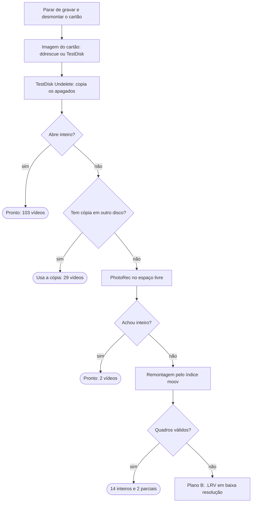

# Recuperando vídeos apagados de um cartão SD da GoPro

[English](README.md) · **Português** · [Español](README.es.md)

De 155 vídeos apagados de um cartão da GoPro, 148 voltaram inteiros em Full HD e 2 voltaram pela metade, só com ferramentas gratuitas. Este guia mostra o passo a passo no Linux, no macOS e no Windows, e os scripts em [`scripts/`](scripts/) remontam os vídeos que nenhuma ferramenta pronta conseguiu.

> **Testado em:** Linux (Arch). Os comandos de macOS e Windows seguem a documentação de cada ferramenta, mas não foram rodados nesses sistemas. Os scripts foram feitos para **FAT32 + GoPro** (`GH*.MP4`); outras câmeras ou sistemas de arquivos precisam de ajuste.

## Conteúdo

- [O que aconteceu](#o-que-aconteceu)
- [Regra de ouro: parar de gravar no cartão](#regra-de-ouro-parar-de-gravar-no-cartão)
- [Visão geral](#visão-geral)
- [Ferramentas](#ferramentas)
- [Passo 1: identificar o cartão](#passo-1-identificar-o-cartão)
- [Passo 2: fazer a imagem do cartão](#passo-2-fazer-a-imagem-do-cartão)
- [Passo 3: TestDisk Undelete](#passo-3-testdisk-undelete)
- [Passo 4: conferir os vídeos e limpar duplicatas](#passo-4-conferir-os-vídeos-e-limpar-duplicatas)
- [Passo 5: PhotoRec no espaço livre](#passo-5-photorec-no-espaço-livre)
- [Passo 6 (avançado): remontar vídeos fragmentados](#passo-6-avançado-remontar-vídeos-fragmentados)
- [Plano B: os arquivos LRV e o upscale](#plano-b-os-arquivos-lrv-e-o-upscale)
- [Resultado deste caso](#resultado-deste-caso)
- [Armadilhas](#armadilhas)

## O que aconteceu

Os vídeos sumiram em três passos no computador, mas continuavam fisicamente no cartão: um microSD de 32 GB em FAT32, de uma GoPro, com 153 vídeos gravados em dois dias.

| Quando | O que foi feito | Efeito no cartão |
| --- | --- | --- |
| 07:48 | Os `.MP4` foram movidos do cartão para uma pasta em outro disco | Mover para outro disco = copiar e apagar do cartão |
| 07:59 | Parte dos vídeos foi apagada dessa pasta | Os vídeos foram para a lixeira desse disco |
| 08:18 | A lixeira foi esvaziada | Dos 153, só 51 continuavam no outro disco |

Apagar um arquivo em FAT32 não zera os dados. O sistema só marca a entrada do diretório como apagada e libera os blocos (clusters) na tabela FAT. O conteúdo continua lá até alguma gravação nova cair por cima.

Três coisas jogaram a favor:

- O cartão não recebeu nenhuma gravação depois que os vídeos foram movidos, e 27 dos 30 GB estavam livres.
- A GoPro grava, junto de cada vídeo, um `.LRV` (cópia em 768×432) e um `.THM` (miniatura). Esses arquivos não foram apagados e serviram de rede de segurança e de referência.
- Os 51 vídeos que sobraram no outro disco estavam íntegros e cobriram parte dos que vieram corrompidos do cartão.

## Regra de ouro: parar de gravar no cartão

Cada gravação nova no cartão pode destruir de vez um arquivo apagado, então o primeiro passo é parar de usá-lo.

- Não grave nada na câmera nem copie arquivos para o cartão.
- Não formate e não aceite "reparar" ou "verificar e corrigir".
- Não salve os arquivos recuperados no próprio cartão.
- Desmonte o cartão assim que possível. Enquanto ele está montado, o sistema pode gravar miniaturas, índices ou lixeira nele.

| Sistema | Como desmontar sem gravar |
| --- | --- |
| Linux (qualquer distro) | `udisksctl unmount -b /dev/sdX1` (ou `sudo umount /dev/sdX1`) |
| macOS | `diskutil unmountDisk /dev/diskN` |
| Windows | Ejetar pelo Explorer, ou deixar o disco somente leitura: `diskpart` → `list disk` → `select disk N` → `attributes disk set readonly` |

No Windows, o cartão conectado costuma ganhar uma pasta `System Volume Information`, e o sistema pode oferecer "verificar e corrigir". Recuse. O modo somente leitura do `diskpart` evita as duas coisas.

## Visão geral

A recuperação é uma sequência de tentativas, da mais simples para a mais trabalhosa. Cada vídeo que volta inteiro sai da fila, e só os que falharam seguem para a etapa seguinte. Os números são deste caso (155 vídeos).



## Ferramentas

Tudo aqui é gratuito e de código aberto. O TestDisk e o PhotoRec vêm no mesmo pacote.

| Ferramenta | Para quê | Obrigatória? |
| --- | --- | --- |
| [TestDisk / PhotoRec](https://www.cgsecurity.org/wiki/TestDisk) | Recuperar apagados com nome (TestDisk) e por assinatura (PhotoRec) | Sim |
| [GNU ddrescue](https://www.gnu.org/software/ddrescue/) | Fazer a imagem do cartão, tolerando setores ruins | Recomendada (no Windows, use o TestDisk) |
| [FFmpeg](https://ffmpeg.org/) (`ffmpeg` e `ffprobe`) | Conferir se o vídeo abre, cortar e fazer upscale | Sim, para conferir |
| [Python 3](https://www.python.org/) | Rodar os scripts do Passo 6 | Só no Passo 6 |
| [untrunc](https://github.com/anthwlock/untrunc) | Reconstruir o índice de um MP4 truncado | Opcional (não resolveu este caso) |

### Instalação

| Sistema | Comando |
| --- | --- |
| Ubuntu / Debian / Mint | `sudo apt install testdisk gddrescue ffmpeg python3` |
| Fedora | `sudo dnf install testdisk ddrescue ffmpeg-free python3` |
| Arch / Manjaro | `sudo pacman -S testdisk ddrescue ffmpeg python` |
| openSUSE | `sudo zypper install testdisk ddrescue ffmpeg python3` |
| macOS ([Homebrew](https://brew.sh/)) | `brew install testdisk ddrescue ffmpeg python` |
| Windows | TestDisk: baixe o `.zip` para Windows no [site oficial](https://www.cgsecurity.org/wiki/TestDisk_Download) e extraia. FFmpeg e Python: `winget install Gyan.FFmpeg` e `winget install Python.Python.3.12` |

Nomes de pacote mudam entre versões das distros. Se um não existir, procure com `apt search`, `dnf search`, `pacman -Ss` ou `zypper search`. No Fedora e no openSUSE, o FFmpeg completo vem de repositórios extras (RPM Fusion e Packman), mas a versão básica já serve para conferir vídeos.

O `untrunc` tem pacote no Arch, pelo AUR (`yay -S untrunc-git`). Se a sua distro não tiver pacote, compile a partir do [código-fonte](https://github.com/anthwlock/untrunc).

## Passo 1: identificar o cartão

Antes de qualquer comando que leia o disco, confirme o nome do dispositivo pelo tamanho. Errar o disco aqui significa ler, ou pior, gravar no disco errado.

| Sistema | Comando | Como o cartão aparece |
| --- | --- | --- |
| Linux | `lsblk -o NAME,SIZE,FSTYPE,LABEL,MOUNTPOINT` | `/dev/sdX` (leitor USB) ou `/dev/mmcblk0` (leitor embutido) |
| macOS | `diskutil list` | `/dev/diskN` (external, physical) |
| Windows | Gerenciamento de Disco (`diskmgmt.msc`) ou, no PowerShell, `Get-Disk` | Disco N, removível |

Neste caso, o `lsblk` mostrou:

```
sdc          29.7G
└─sdc1       29.7G vfat   /run/media/usuario/FA9E-2B30
```

29,7 GB é o tamanho real de um cartão vendido como 32 GB, e `vfat` é o FAT32. O disco inteiro é `sdc` e a partição é `sdc1`. A imagem do Passo 2 deve ser do disco inteiro.

Se o cartão não aparecer em nenhum leitor, a falha é física e nenhum programa resolve. O caminho aí é um laboratório de recuperação.

## Passo 2: fazer a imagem do cartão

A imagem é uma cópia bit a bit do cartão inteiro, incluindo o espaço livre onde estão os apagados. Todo o resto do trabalho é feito nela, e o cartão fica guardado intacto.

Isso protege um cartão que esteja falhando, permite repetir qualquer tentativa sem risco e deixa ler o cartão uma vez só. Você precisa de espaço livre maior que o cartão (32 GB para um cartão de 32 GB), **fora do cartão**.

### Linux e macOS: ddrescue

```bash
# Linux (troque sdc pelo seu disco: o disco inteiro, sem número)
sudo ddrescue -d -r3 /dev/sdc ~/sdcard.img ~/sdcard.map

# macOS (troque 4 pelo número do diskutil; rdisk é mais rápido que disk)
diskutil unmountDisk /dev/disk4
sudo ddrescue -r3 /dev/rdisk4 ~/sdcard.img ~/sdcard.map
```

- `-d` lê direto do dispositivo, sem cache (só no Linux).
- `-r3` tenta de novo, até 3 vezes, os setores que derem erro.
- O arquivo `.map` registra o progresso. Se a cópia for interrompida, rode o mesmo comando e ela continua de onde parou.

No fim, confira o `.map`: o status `+` no intervalo inteiro quer dizer que todos os setores foram lidos. Neste caso, foram 31,9 GB sem nenhum erro.

### Windows: TestDisk (Image Creation)

O próprio TestDisk cria a imagem, e o arquivo gerado serve nos passos seguintes.

1. Abra o `testdisk_win.exe` como administrador.
2. `Create` (sem log) e selecione o cartão pelo tamanho.
3. Tipo de tabela: `Intel`.
4. `Advanced`, selecione a partição FAT32 e escolha `Image Creation`.
5. Escolha uma pasta de destino em outro disco. O TestDisk grava um arquivo `image.dd`.

Pelo `Image Creation` a imagem é só da partição, não do disco inteiro. Para este tipo de recuperação isso basta, e os scripts do Passo 6 aceitam os dois tipos de imagem.

## Passo 3: TestDisk Undelete

O TestDisk lê as entradas apagadas do diretório e devolve os arquivos com o nome original. Neste caso, foi a etapa que mais recuperou: 103 vídeos inteiros de uma vez.

Crie antes a pasta de destino e abra o TestDisk apontando para a imagem:

```bash
mkdir ~/recuperado
testdisk ~/sdcard.img        # Linux e macOS
```

No Windows, abra o `testdisk_win.exe` e escolha o `image.dd`, ou rode `testdisk_win.exe image.dd` no terminal.

| Tela | O que fazer | Observação |
| --- | --- | --- |
| Seleção do disco | Selecione a imagem e `Proceed` | `(RO)` quer dizer somente leitura. É o esperado |
| "Write access for this media is not available" | `Continue` | Só avisa que a imagem não será alterada, e isso é bom |
| Tipo de tabela | `Intel` (sugerido) | Cartões SD usam tabela MBR |
| Menu principal | `Advanced` | |
| Lista de partições | Selecione a FAT32 e vá com a **seta para a direita** até `Undelete` | A primeira opção é `Boot`: não entre nela |
| Raiz do cartão | Seta para a direita em `DCIM` e depois em `100GOPRO` | Os horários aparecem em UTC |
| Lista de arquivos | Os apagados aparecem **em vermelho**, com `_` no lugar da primeira letra (`_H012073.MP4`) | Os brancos são os que ainda existem |
| Seleção | `a` marca todos; `:` marca só o arquivo atual | O `a` marca **tudo**, inclusive o que não foi apagado |
| Cópia | `C` (maiúsculo), escolha a pasta de destino e `C` de novo | No fim: `Copy done! N ok, M failed` |

### Armadilhas desta etapa

- **A tela de `Boot`.** Ela mostra `Boot sector OK` e o aviso *First sectors … are not identical*, que é comum e inofensivo. **Nunca** use `Org. BS`, `Backup BS` nem `Rebuild BS` só para recuperar arquivos: essas opções regravam o setor de boot. Saia com `Quit`.
- **Mais arquivos do que o esperado.** Aqui foram 621 arquivos para 153 vídeos, por dois motivos. O `a` copiou também os `.LRV`, `.THM` e `.JPG` que ainda existiam. E uma pasta que também tinha sido criada e apagada no cartão guardava uma segunda entrada apagada para os mesmos vídeos. O Passo 4 limpa isso.
- **Arquivo copiado não é arquivo bom.** O TestDisk lê a partir do primeiro bloco do arquivo e segue em sequência. Se o vídeo foi gravado espalhado pelo cartão, a cópia sai com o tamanho certo e o conteúdo errado. Nenhum aviso aparece: só dá para saber conferindo, no Passo 4.

## Passo 4: conferir os vídeos e limpar duplicatas

Um vídeo só conta como recuperado se abrir e decodificar do começo ao fim. Dos 155 MP4 que o TestDisk copiou aqui, 103 passaram e 52 vieram corrompidos, com a mensagem `moov atom not found`.

### 1. Conferir cada vídeo

O teste rápido lê a duração pelo índice e decodifica os 2 últimos segundos. O teste completo decodifica o vídeo inteiro e é mais lento.

```bash
# Linux e macOS
cd ~/recuperado/DCIM/100GOPRO
for f in _H*.MP4; do
  d=$(ffprobe -v error -show_entries format=duration -of csv=p=0 "$f")
  e=$(ffmpeg -v error -sseof -2 -i "$f" -f null - 2>&1 | head -1)
  echo "$f | duração=${d:-ERRO} | ${e:-ok}"
done

# teste completo de um arquivo (nenhuma linha = nenhum erro)
ffmpeg -v error -i GH012107.MP4 -f null -
```

```powershell
# Windows (PowerShell)
cd $HOME\recuperado\DCIM\100GOPRO
Get-ChildItem _H*.MP4 | ForEach-Object {
  $d = ffprobe -v error -show_entries format=duration -of csv=p=0 $_.Name
  "$($_.Name) | duração=$d"
}
```

Compare a duração com a do `.LRV` do mesmo número (`GL012107.LRV` é o par de `GH012107.MP4`). Se as duas baterem e o teste não mostrar erro, o vídeo está bom.

### 2. Remover duplicatas com segurança

Só apague um arquivo depois de confirmar, byte a byte, que ele é idêntico a outro que vai ficar.

```bash
# Linux e macOS: apaga a segunda cópia só se for idêntica
for f in segunda_pasta/*.MP4; do cmp -s "$f" "${f#segunda_pasta/}" && rm "$f"; done
```

```powershell
# Windows: compara pelo hash
Get-ChildItem segunda_pasta\*.MP4 | ForEach-Object {
  if ((Get-FileHash $_.FullName).Hash -eq (Get-FileHash $_.Name).Hash) { Remove-Item $_.FullName }
}
```

### 3. Organizar

- Mova os que passaram para uma pasta `videos` e os que falharam para `corrompidos`.
- Renomeie `_H0…` para `GH0…`. Em bash: `for f in _H*.MP4; do mv "$f" "G${f#_}"; done`. Em PowerShell: `Get-ChildItem _H*.MP4 | Rename-Item -NewName { 'G' + $_.Name.Substring(1) }`.
- Procure cópias boas em outros discos antes de insistir nos corrompidos. Aqui, 29 dos 52 corrompidos estavam íntegros no outro disco, e bastou compará-los pelo nome e pelo tamanho exato em bytes.

## Passo 5: PhotoRec no espaço livre

O PhotoRec ignora o sistema de arquivos e procura assinaturas de arquivo no espaço livre, como o cabeçalho de um MP4. Aqui ele achou 132 vídeos, mas quase todos já tinham sido salvos pelo TestDisk: só 2 eram novos.

Os arquivos voltam com nomes genéricos (`f3358528.mp4`). Para saber qual é qual, compare a data de gravação interna (`creation_time`) e a duração com as do `.LRV`.

### Modo interativo (qualquer sistema)

```bash
photorec ~/sdcard.img            # Linux e macOS
photorec_win.exe image.dd        # Windows (ou qphotorec_win.exe, com janela)
```

1. Selecione a imagem e a partição FAT32.
2. Em `File Opt`, aperte `s` para desmarcar tudo e marque só `mov`. É nesse tipo que o PhotoRec detecta MP4.
3. `Search`, depois `Other` (tipo de sistema de arquivos para FAT/NTFS) e depois `Free` (só o espaço livre).
4. Escolha uma pasta de destino fora do cartão e confirme com `C`.

### Modo automático (Linux e macOS)

```bash
photorec /log /d ~/recuperado/photorec/r /cmd ~/sdcard.img \
  1,fileopt,everything,disable,mov,enable,freespace,search
```

### Identificar os recuperados

```bash
ffprobe -v error -show_entries format=duration:format_tags=creation_time \
  -of csv=p=0 arquivo.mp4
```

Um arquivo do PhotoRec pertence a um vídeo quando o `creation_time` e a duração batem com as do `.LRV` daquele vídeo.

## Passo 6 (avançado): remontar vídeos fragmentados

Os vídeos que nenhuma ferramenta pronta salvou foram remontados por script, bloco a bloco, usando o índice do próprio vídeo como guia. Assim voltaram 14 vídeos inteiros e 2 parciais, de 17 tentativas.

### Por que o TestDisk e o PhotoRec falharam nesses vídeos

A GoPro grava o MP4 e o `.LRV` **ao mesmo tempo**, e por isso os dois ficam intercalados no cartão. Neste cartão, o padrão foi de 160 blocos de 32 KB do MP4 (5 MB), seguidos de 16 blocos do LRV (512 KB), e assim por diante:

```
cartão: [MP4 5 MB][LRV 512 KB][MP4 5 MB][LRV 512 KB][MP4 5 MB] ...
```

Além disso, o começo do vídeo às vezes fica em outra região do cartão. Quando o arquivo é apagado, some a tabela que dizia a ordem desses pedaços. O TestDisk e o PhotoRec leem em sequência, e por isso juntam pedaços do LRV e de outros vídeos no meio do MP4.

O `untrunc` também não resolveu. Ele reconstrói o índice de um MP4 cortado, mas aqui o índice estava íntegro; o que estava fora de ordem eram os dados.

### Como a remontagem funciona

No fim de cada MP4 da GoPro fica o `moov`, o índice que diz a posição e o tamanho exatos de cada quadro de vídeo. Ele sobrevive no cartão e funciona como um mapa.

1. **Achar os índices soltos.** O [`scan_moov.py`](scripts/scan_moov.py) varre a imagem atrás de todos os `moov`. Aqui, achou 308: um por MP4 e um por LRV.
2. **Descobrir de qual vídeo é cada índice.** A data de gravação e a duração do `moov` são iguais às do `.LRV` do mesmo vídeo. Isso identificou 19 dos 21 que faltavam.
3. **Achar o começo.** O primeiro bloco da cópia do TestDisk estava certo. O [`rebuild_mp4.py`](scripts/rebuild_mp4.py) procura esse bloco na imagem e começa dali.
4. **Seguir bloco a bloco, conferindo cada quadro.** Um quadro H.264 é uma sequência de pedaços cujos tamanhos têm de somar exatamente o tamanho que o índice diz. Se somam, os blocos estão certos. Se não, o script procura na imagem o bloco onde o quadro fecha e continua dali.
5. **Fazer o mesmo de trás para frente**, a partir do fim do `moov`, e juntar as duas metades. Se sobrar um buraco no meio, ele fica só naquele trecho.
6. **Conferir o resultado** com `ffmpeg -v error -i video.MP4 -f null -` e olhando alguns quadros.

### Como usar os scripts

Eles precisam de Python 3 (só a biblioteca padrão) e do `ffprobe` no PATH. Nenhum deles grava na imagem.

```bash
# 1. lista todos os índices da imagem: posição, tamanho, data (UTC), duração
python3 scripts/scan_moov.py sdcard.img > moovs.txt

# 2. data e duração do .LRV do vídeo que falta
ffprobe -v error -show_entries format=duration:format_tags=creation_time \
  -of csv=p=0 GL012107.LRV

# 3. em moovs.txt, procure as linhas com a mesma data e duração
#    (normalmente duas: uma do MP4 e outra do LRV)

# 4. remonte com cada uma; a do LRV é recusada ("does not line up")
python3 scripts/rebuild_mp4.py sdcard.img <posição> <tamanho> corrompidos/GH012107.MP4 remontados/GH012107.MP4

# 5. confira
ffmpeg -v error -i remontados/GH012107.MP4 -f null -
```

O 4º argumento é a cópia corrompida que o TestDisk gerou: o script usa o primeiro bloco dela como ponto de partida. No Windows, troque `python3` por `py`. Os scripts aceitam tanto a imagem do disco inteiro (`sdcard.img`) quanto a da partição gerada pelo TestDisk (`image.dd`).

Se o vídeo sair parcial, salve só o trecho bom, sem recodificar, usando o número de quadros que a passada para frente mostrou: `ffmpeg -i GH012161.MP4 -t 12.7 -map 0:v -map 0:a -c copy GH012161_parcial.MP4` (782 quadros ÷ 59,94 fps ≈ 13 s).

### Teste

O [`tests/run_test.sh`](tests/run_test.sh) cria duas imagens FAT32 sintéticas (só a partição e o disco inteiro com MBR), espalha dentro delas um vídeo real da GoPro do jeito que a câmera faz e confere se o arquivo remontado é idêntico byte a byte ao original. Precisa de Linux com `mkfs.fat` e `sfdisk`.

```bash
tests/run_test.sh caminho/para/GH0xxxxx.MP4
```

### O que aprendemos no caminho

- **Não confie na tabela FAT para esses vídeos.** Parte dos blocos de um vídeo estava registrada como pertencente ao `.LRV` de outro vídeo. O script só dá certo porque se guia pela conferência dos quadros, e não por "bloco livre ou ocupado".
- **A entrada de diretório pode mentir o tamanho.** Um vídeo constava com 107 MB, mas o cabeçalho do próprio vídeo (`ftyp` + `free` + `mdat` + `moov`) dizia 181 MB. O tamanho certo é o do cabeçalho.
- **Procure primeiro perto.** A primeira versão, que varria a imagem inteira a cada salto, levou 43 minutos para um vídeo. Buscando antes nos 20 mil blocos seguintes, 11 vídeos levaram 13 minutos.

## Plano B: os arquivos LRV e o upscale

O `.LRV` não recupera o vídeo original, mas garante que nenhuma cena se perca de vez. Aqui, cada vídeo que não voltou inteiro ainda tinha o seu `.LRV`, com exceção de dois cujo `.LRV` também estava danificado.

- **O que é:** uma segunda gravação da mesma cena, feita pela GoPro ao mesmo tempo, em 768×432 a 60 fps e cerca de 4 Mbps. É um MP4 comum com outra extensão, e abre no VLC ou no mpv.
- **O que não é:** um pedaço do MP4. O detalhe que só existia no original não está no `.LRV`, e nenhum programa consegue tirá-lo de lá.
- **Guarde os `.LRV` antes de tudo.** Eles continuam no cartão e são a rede de segurança. Copie a pasta `DCIM` inteira para o computador logo no começo.

### Upscale simples (FFmpeg, qualquer sistema)

Deixa o vídeo em 1080p, mais liso e sem blocos de pixel, mas sem detalhe novo. Serve para editar junto com vídeos Full HD.

```bash
ffmpeg -i GL012133.LRV -vf "scale=1920:1080:flags=lanczos,unsharp=5:5:0.6" \
  -c:v libx264 -crf 18 -preset fast -c:a copy GH012133_1080p.mp4
```

No PowerShell, o mesmo comando funciona trocando a `\` do fim da linha por uma crase (`` ` ``), ou escrevendo tudo numa linha só. No teste, `-preset slow` levou 1 min 50 s para 26 s de vídeo; `-preset fast` leva mais ou menos a metade.

### Upscale com IA

Ferramentas como o Real-ESRGAN (via [Video2X](https://github.com/k4yt3x/video2x), gratuito) ou o Topaz Video AI (pago) deixam a imagem mais nítida, mas **inventam** detalhe plausível. É uma aproximação, não o original. Numa GPU integrada é muito lento (pela estimativa deste caso, cerca de 1 hora para um clipe de 2 minutos a 60 fps), então vale só para os clipes mais importantes.

## Resultado deste caso

148 dos 155 vídeos voltaram inteiros, em 1920×1080 e com áudio. Quatro deles têm 1 quadro danificado, o que dá no máximo uma falha de menos de 1 segundo na imagem.

| Etapa | Vídeos salvos | Tempo aproximado |
| --- | --- | --- |
| TestDisk Undelete | 103 | minutos |
| Cópia que sobrou no outro disco | 29 | segundos |
| PhotoRec no espaço livre | 2 | cerca de 30 min |
| Remontagem pelo índice | 14 inteiros + 2 parciais | 43 min (1º vídeo) + cerca de 30 min (os outros 16) |
| **Total** | **148 inteiros + 2 parciais** | |

Os 7 que não voltaram inteiros:

| Vídeo | Duração | Situação | O que sobrou |
| --- | --- | --- | --- |
| `GH012236` | 32 s | Parcial: 19 s bons | Trecho + `.LRV` inteiro |
| `GH012161` | 48 s | Parcial: 13 s bons | Trecho + `.LRV` inteiro |
| `GH012133` | 6 s | Perdido: só 0,15 s bons | `.LRV` inteiro |
| `GH012077`, `GH012078` | 1 s cada | Descartados (gravação acidental) | `.LRV` |
| `GH012227`, `GH012228` | ? | Sem índice no cartão, fora da tentativa | Só a miniatura |

## Armadilhas

Nenhum desses erros custou dados, mas cada um tomou tempo.

| O que aconteceu | Por quê | Como evitar |
| --- | --- | --- |
| Entrar na tela `Boot` do TestDisk em vez de `Undelete` | As opções ficam lado a lado no menu | Siga com a seta para a direita até `Undelete`. Na tela `Boot`, só `Quit` |
| 621 arquivos copiados para 153 vídeos | O `a` marca tudo, e havia duas entradas apagadas por vídeo | Conferir e deduplicar no Passo 4 |
| Vídeo copiado com tamanho certo, mas que não abre | Vídeo gravado espalhado; o TestDisk lê em sequência | Sempre conferir com `ffmpeg` antes de apagar qualquer coisa |
| `Client.Timeout exceeded` ao instalar pelo AUR | O AUR estava instável | Clonar pelo espelho no GitHub: `git clone --branch untrunc-git --single-branch https://github.com/archlinux/aur.git` e depois `makepkg -si` |
| `command not found: cp` no meio de um script | No zsh, `path` é a mesma variável que o `PATH`; usar `path` como nome apagou o `PATH` | Nunca use `path` como nome de variável no zsh |
| O `untrunc` parou em 6% da imagem | Um trecho de dados inválidos derrubou a varredura | Varrer com um script próprio (`scan_moov.py`) |
| Remontagem abortando por "alinhamento" | A entrada de diretório registrava o tamanho errado | Calcular o tamanho pelo cabeçalho do MP4 |

Cuidados que valeram a pena:

- Trabalhar sempre na imagem, com o cartão guardado.
- Salvar tudo num disco com folga.
- Apagar só o que foi confirmado byte a byte como duplicado.
- Formatar o cartão só depois de conferir os vídeos no destino final.

## Licença

[MIT](LICENSE)
